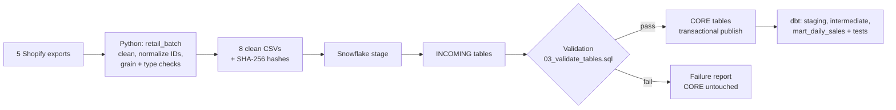
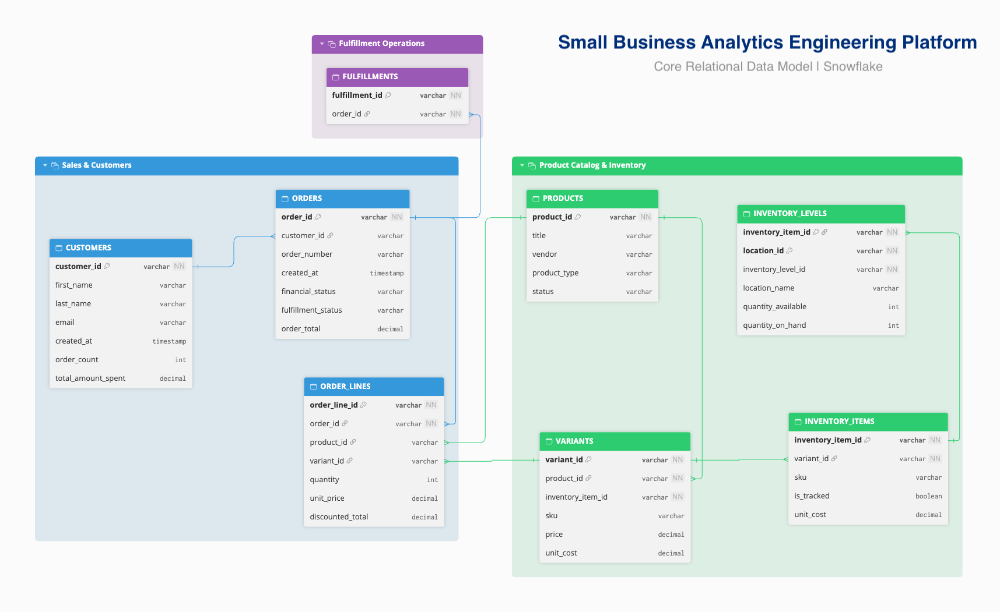

# Retail Analytics Pipeline

A batch pipeline that turns raw Shopify exports from a small e-commerce business into a validated, reproducible Snowflake data model.

> **Status: work in progress.** The Python batch loader is complete and tested, live batches have been published to Snowflake CORE, and the first dbt mart (daily sales) is built with tests. Next up: more marts, and hardening runs across machines. See [Roadmap](#status-and-roadmap).

## Why this exists

I co-founded Retail Business, a Shopify-based retail business. Shopify's exports are not analysis-ready: IDs need normalizing, grains are inconsistent, and nothing guarantees that an export is complete. This project builds the foundation that reporting can trust: clean tables, checked in the warehouse before anything is published.

## Architecture



## Data model

Five exports become eight tables: customers, orders, order lines, fulfillments, products, variants, inventory items and inventory levels.



Inventory levels are keyed on `(inventory_item_id, location_id)`, kept consistent across the notebook, the cleaning module and the SQL.

## Design decisions

**1. Full snapshot replacement instead of incremental loads.**
The exports contain full history (customers and orders back to 2022), not daily changes. Replacing the whole snapshot keeps reruns idempotent: running the same batch twice never appends duplicates.
*Tradeoff:* incremental batches are rejected, because an overwrite would delete unchanged rows, and run cost grows with history.

**2. Validate in a staging layer before publishing.**
Data lands in freshly recreated INCOMING tables, every check in `03_validate_tables.sql` runs, and only a passing batch is published to CORE, in a single transaction that rolls back on error.
*Tradeoff:* extra tables and a slower run, in exchange for CORE never holding a half-loaded or failed batch.

**3. A manifest as the completeness gate.**
Code cannot prove that Shopify's exporter finished. So each batch requires a `batch.json` manifest recording that check, and the loader fails on missing, ambiguous, empty or changing files.
*Tradeoff:* a manual step, made explicit instead of assumed.

**4. Observations vs. blocking checks.**
Some anomalies are real business facts: guest checkouts have no customer ID, historical orders reference retired products, and inventory can go negative. These are logged as observations. A populated reference that matches nothing fails the batch.
*Tradeoff:* each rule is a judgment call about which data issues reflect the business and which reflect a broken load.

**5. Reproducibility by hashing.**
Every run records SHA-256 hashes of its sources and outputs, plus row counts. Two independent runs on the same batch produced identical hashes, and destination counts must equal local counts.

## Running it

Requires Python 3.10+ and Snowflake credentials in `.env` (see `.env.example`).

```sh
python -m pip install -r requirements.txt
python -m retail_batch --batch-date YYYY-MM-DD --manifest batch.json         # local checks only
python -m retail_batch --batch-date YYYY-MM-DD --manifest batch.json --live  # upload, validate, publish
```

The business's real data is not included in this repository. Full operating details (manifest format, file contracts, locking and rerun behavior) are in [RUNBOOK.md](RUNBOOK.md).

To build the dbt models as well, install `requirements-dbt.txt`, which includes `requirements.txt` and adds dbt:

```sh
python -m pip install -r requirements-dbt.txt
python dbt/run.py build
```

## Repository guardrails

Credentials and private business data never enter the repo:

- **Settings:** credentials and paths live in a gitignored `.env`; `.env.example` lists the required settings with placeholders. Snowflake sign-in uses key-pair authentication (a private `.p8` key file), not a password.
- **`.gitignore`:** blocks data exports (`*.csv`, `*.xlsx`, `*.parquet`), keys and certificates, and local run artifacts anywhere in the repo.
- **Pre-commit checks** (`.pre-commit-config.yaml`): gitleaks for secrets, notebook output stripping, a 500 KB file-size limit, private-key and merge-conflict detection, and `scripts/check_sensitive.py` for emails, phone numbers and private terms. Install once per clone with `pre-commit install`.

## Testing

```sh
python -m unittest discover -s tests -v
```

Eight unit tests cover the batch loader's warehouse contracts: COPY statement detection, orphan and reference rules, count and reconciliation failures, preflight errors, and rollback on a failed publish. In dbt, `dbt/run.py build` runs schema tests (unique and not-null keys on every model) plus two singular tests: one checks daily sales for impossible counts, and one re-aggregates order headers independently to catch dropped orders, duplicates and join fan-out.

## Status and roadmap

**Done**
- Python batch loader extracted from the original cleaning notebook, with its assertions preserved
- Warehouse load, validation and transactional publish scripts
- Deterministic local runs verified by matching hashes
- dbt layer: staging (orders, order lines), an intermediate join, and `mart_daily_sales`, with schema and reconciliation tests (see [dbt/README.md](dbt/README.md))
- Live batches loaded, validated and published to CORE
- Repository guardrails: gitignore rules and pre-commit secret and sensitive-data checks

**Next**
- More marts (customers and RFM, products, inventory)
- Orchestration, cross-host locking and stale-batch protection
- A dependency lock file for reproducible installs
- CI/CD around the existing data contracts
